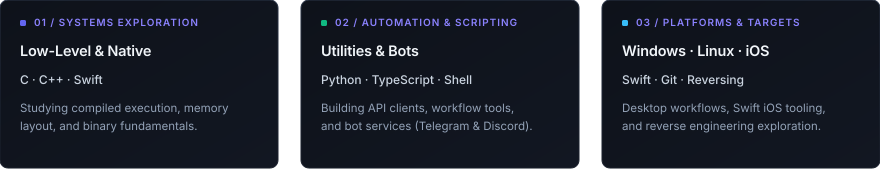

  

&nbsp;&nbsp;

&nbsp;&nbsp;

 

### About &amp; Focus

I am an Information Technology student based in Libya. My technical interests center on **software development**, **low-level systems**, **binary analysis**, and **developer tooling**.

I am interested in understanding how software operates from the binary up—exploring compiled runtimes, memory behavior, and systems interfaces, alongside building practical utilities, API integrations, and automation scripts.

 

 

### Learning &amp; Exploration

 

* **Low-Level &amp; Systems**: Exploring native execution, memory structure, and binary fundamentals with **C**, **C++**, and **Swift**.
* **Automation &amp; Scripting**: Writing utilities, API integrations, and bot workflows (Telegram &amp; Discord) with **Python** and **TypeScript / JavaScript**.
* **Platforms &amp; Tooling**: Daily development workflows centered on **Windows** and **Linux**, with disciplined version control via **Git**.
* **iOS &amp; Reverse Engineering**: Building iOS tools with **Swift**, researching binary structures, and exploring reverse engineering.

 

 

### Contribution Stream

  

 

 

  
   
  <a href="https://abdoat.me">abdoat.me</a> &nbsp;·&nbsp; <a href="https://github.com/xAbdoAT">@xAbdoAT</a>

